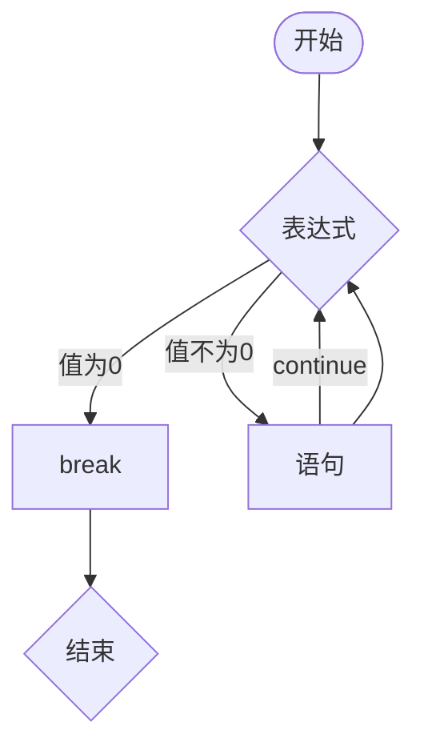
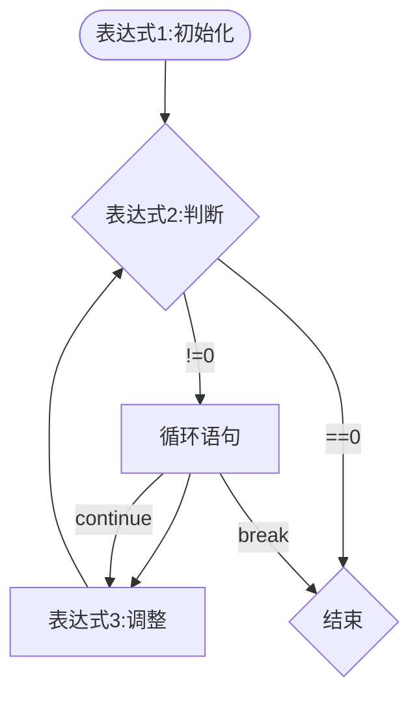
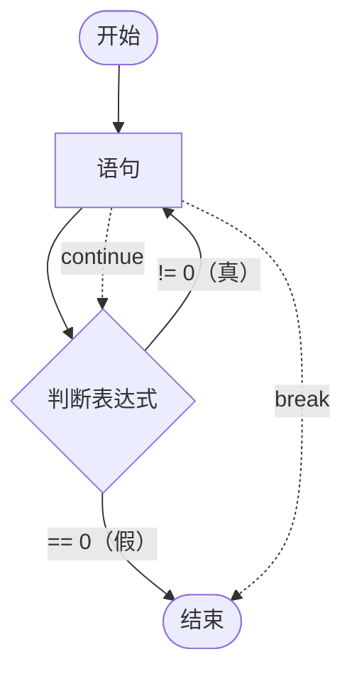

# 目录

- [一、分支语句]
  - [1.if语句]
  - [2. 关系操作符]
  - [3. 条件操作符]
  - [4. 逻辑操作符]
  - [5. switch语句]
- [二、循环语句]
  - [6. while循环]
  - [7. for循环]
  - [8. do-while循环]
  - [9. break和continue语句]
  - [10. 循环的嵌套]
  - [11. goto语句]
- [三、游戏]
  -[12. 随机数生成]
  -[13. 猜数字游戏]
	


### 前摘
C语言使结构化（顺序，分支，循环结构）的程序设计语言。
if、switch实现分支结构，while、for、do-while实现循环结构。

## 一、分支语句

### 1.if语句
#### if-else语句
if语句是C语言中最基本的分支语句，if语句的基本形式如下：
```c
if（表达式）
{
    语句;
}
```
在C语言中,0为假,非0表示真,
判断一个数是不是奇数：
```c
int x = 0;
	scanf("%d", &x);
	if (x % 2 == 1)
	{
		printf("x是奇数\n");
	}
```

else语句的基本形式如下：
```c
if（表达式）
{
	语句;
}
else
{
	语句;
}
```
判断一个数是奇数还是偶数：
```C
int z = 0;
	scanf("%d", &z);
	if (z % 2 == 1)
		printf("z是奇数\n");
	else
		printf("z是偶数\n");
	return 0;
```

分支中包含多条语句时，必须使用**大括号{}**将这些语句括起来，否则只会执行第一条语句。
```c
	int c = 0;
	scanf("%d", &c);
	if (c % 2 == 1)
	{
		printf("c %% 2 = %d\n", c % 2);
		printf("c是奇数\n");
	}
	else
	{
		printf("c %% 2 = %d\n", c % 2);
		printf("c是偶数\n");
	}
```


#### 嵌套if语句
在 if else 语句中,else 可以与另一个 if 语句连用,构成多重判断。
eg1.输入一个整数,判断输入的整数是0,还是正数或者负数。
```C
	int v = 0;
	scanf("%d", &v);
	//写法1：
	if (v > 0)
		printf("v是正数\n");
	else
	{
		if (v < 0)
			printf("v是负数\n");
		else
			printf("v是0\n");
	}
	//写法2：
	if (v > 0)
		printf("v是正数\n");
	else if (v < 0)
		printf("v是负数\n");
	else
		printf("v是0\n");
```

eg2.输入一个整数,如果是正数,再判断是奇数还是偶数,并输出;如果不是正数则输出:非正数。
```c
	int b = 0;
	scanf("%d", &b);
	if (b > 0)
	{
		if (b % 2 == 1)
			printf("b是奇数\n");
		else
			printf("b是偶数\n");
	}
	else
		printf("b是非正数\n");
```

eg3.输入一个人的年龄  
如果年龄<18岁,打印“少年”  
如果年龄在18岁至44岁打印“青年”  
如果年龄在45岁至59岁打印“中老年”  
如果年龄在60岁至89岁打印“老年”    
如果90岁及以上打印“老寿星”
```c
	int age = 0;
	scanf("%d", &age);
	if (age < 18)
		printf("未成年\n");
	else if (age <= 44)
		printf("青年\n");
	else if (age <= 59)
		printf("中年\n");
	else if (age <= 89)
		printf("老年");
	else 
		printf("老寿星\n");
```


#### else悬空
else总是与最近的if语句匹配,如果if语句中有大括号,则else与if语句匹配,否则else与最近的if语句匹配。
```C
	int n = 0;
	int m = 2;
	if (n == 1)
		if (m == 2)
			printf("hehe");
	else
		printf("haha");
```


### 2. 关系操作符
用于比较表达的表达式，称为“关系表达式”使用的运算符就称为“关系运算符”主要有：  
\>、<、>=、<=、==、!=（不相等运算符）
#### 通常返回0/1表示真假
```c
printf("%d\n", 3 > 5);//0
printf("%d\n", 3 > 2);//1
```

#### 通常用于if或while结构。
```c
	int z = 0;
	scanf("%d", &z);//5
	if (z == 5)
		printf("hehe\n");//hehe

	scanf("%d", &z);//3
	if (z = 5)
		printf("hehe\n");hehe

	scanf("%d", &z);//6
	if (5 == z)
		printf("hehe\n");//无输出
	
	scanf("%d", &z);//报错
	if (5 = z)
		printf("hehe\n");
```
所以当一个变量和常量值比较的时候，把常量放在==左边，防止少打一个等号将比较操作符编程赋值操作符。

#### 多个关系运算符不宜连用。
```c
	int x = 3;
	int c = 5;
	int v = 4;
	if (x < c < v)
		printf("hehe\n");
	if (x < c && c < v)
		printf("nihao");
```  
	结果：hehe
`if (x < c < v)`是x和c对比为真得1，然后1与v比为真则打印hehe。
  
    
  
### 3. 条件操作符
  也叫"三木操作符"。
  ```c
  exp1 ? exp2 : exp3
  ```
  逻辑：如果`exp1`为真，`exp2`计算，计算的结果是整个表达式的结果；如果`exp1`为假，`exp3`计算，计算的结果是整个表达式得结果。
  ```c
  	int b = 0;
	int n = 0;
	scanf("%d", &b);//8
	n = (b > 5 ? 3 : -3);
	printf("b = %d、 n = %d", b, n);//b = 8、 n = 3
```
eg.使用表达式实现找两个数中较大值：
```c
	int a = 0;
	int s = 0;
	scanf("%d%d", &a, &s);//5 9 
	int max;
	max = (a > s ? a : s);
	printf("%d", max);//9
```


### 4. 逻辑操作符
&&：逻辑与运算符。
||：逻辑或运算符。
！：逻辑取反运算符。  
#### ！：  
```c
	int flag = 0;
	scanf("%d", &flag);
	if (flag)//flag为真
	{
		printf("hehe\n");
	}
	if (flag == 0)//flag为假
	{
		printf("haha\n");
	}
	if (!flag)//flag为假
	{
		printf("haha\n");
	}
```
`if (!flag)//flag为假``flag`为假，`!flag`即为真。所已执行if语句。  

#### &&:  
春天判断：
```c
	int month;
	scanf("%d", &month);
	if (3 <= month && 5 >= month)
	{
		printf("%d月是春天",month);
	}
```

#### ||：  
春天判断
```c
	int month;
	scanf("%d", &month);
	if (3 == month || 4 == month || 5 == month)
	{
		printf("%d月是春天", month);
	}
```
闰年判断：
```c
	int year = 0;
	scanf("%d", &year);
	if ((year % 4 == 0 && year % 100 ) || （year % 400 == 0）)
		printf("%d是闰年\n", year);
	else
		printf("不是闰年\n");
```
优先级：% 高于 ==，== 高于 &&，&& 高于 ||

#### 短路
C语言**逻辑运算符**还有一个特点,它总是先对**左侧**的表达式求值,再对右边的表达式求值,这个顺序是保证的。  
如果左边的表达式满足逻辑运算符的条件,就不再对右边的表达式求值。这种情况称为"**短路**"<br>
像这种仅仅根据左操作数的结果就能知道整个表达式的结果,不再对右操作数进行计算的运算称为“**短路求值**”。 
```c
	int i = 0, a = 0, b = 2, c = 3, d = 4;
	i = (a++ && ++b && d++);
	printf("%d\t%d\t%d\t%d\n",a,b,c,d);//1       2       3       4
```
```c
	int i = 0, a = 1, b = 2, c = 3, d = 4;
	i = (a++ && ++b && d++);
	printf("%d\t%d\t%d\t%d\n", a, b, c, d);//2       3       3       5
```
```c
	int i = 0, a = 1, b = 2, c = 3, d = 4;
	i = (a++ || ++b || d++);
	printf("%d\t%d\t%d\t%d\n", a, b, c, d);//2       2       3       4
```
```c
	int i = 0, a = 1, b = 2, c = 3, d = 4;
	i = (a++ || ++b || d++);
	printf("%d\t%d\t%d\t%d\n", a, b, c, d);//2       2       3       4
```


#### 优先级
```t
C 语言（C99/C11/C17 基本一致）运算符优先级从高到低如下，同一行优先级相同：

后缀运算符：() [] . -> ++ --
结合性：左
说明：函数调用、数组下标、成员访问、后缀自增/自减。

单目运算符：++ -- + - ! ~ * & sizeof _Alignof (type)
结合性：右
说明：前缀自增/自减、正负号、逻辑非、按位取反、解引用、取地址、sizeof、强制类型转换 (type) 等。

乘除取余：* / %
结合性：左

加减：+ -
结合性：左

移位：<< >>
结合性：左

关系：< <= > >=
结合性：左

相等：== !=
结合性：左

按位与：&
结合性：左

按位异或：^
结合性：左

按位或：|
结合性：左

逻辑与：&&
结合性：左，且短路求值

逻辑或：||
结合性：左，且短路求值

条件运算符：?:
结合性：右

赋值运算符：= += -= *= /= %= <<= >>= &= ^= |=
结合性：右

逗号运算符：,
结合性：左，优先级最低

记忆顺序：

后缀 > 单目 > 乘除 > 加减 > 移位 > 关系 > 相等 > 位与 > 异或 > 位或 > 逻辑与 > 逻辑或 > 条件 > 赋值 > 逗号

注意：

优先级只决定表达式如何结合，不决定操作数求值顺序。例如 f() + g() 中谁先调用并未指定。

&&、||、?: 有短路求值。

a & b == c 解析为 a & (b == c)，因为 == 优先级高于 &；如果想先按位与再比较，应写 (a & b) == c。

*p++ 解析为 *(p++)，因为后缀 ++ 优先级高于单目 *。

a = b = c 解析为 a = (b = c)，赋值右结合。

^ 是按位异或，不是乘方。

声明中的逗号，如 int a = 1, b = 2;，不是逗号运算符
```


### 5. switch语句
switch语句是一种特殊形式得if...else结构，用于判断条件有多个结果的情况。
把多重的else if改成更易用可读性更好的形式。
```c
switch (expression)
{
	case value1:statement
	case value2:statement
	...
	default statement
}
```
根据表达式expression不同的值，执行相应得`case`分支，如果找不到对应得值，就执行`default`分支。
```t
expression必须是整形表达式
case后的值，必须是整型常量表达式
```

#### if语句和switch语句得对比
eg.输入任意一个整数值，计算除3之后的余数
```c
	int r = 0;
	scanf("%d", &r);
	if (r % 3 == 0)
		printf("%d得余数为0", r);
	else if (r % 3 == 1)
		printf("%d的余数为1", r);
	else
		printf("%d的余数为2", r);
```
也可以这样写：
```c
	int x = 0;
	scanf("%d", &x);
	switch (x % 3)
	{
	case 0: printf("%d的余数为0\n", x);
		break;
	case 1: printf("%d的余数为1\n", x);
		break;
	case 2: printf("%d的余数为2\n", x);
		break;
	}
```
注意：  
`case`和后面的数字必须有空格<br>
每一个`case`语句的代码执行完后，都需要加上`break;`才能跳出这个语句。<br>
`default`可加可不加。<br>

#### switch语句中的break\default。
eg.输入一个1-7的数字，打印对应的星期几
```c
	int day = 0;
	scanf("%d", &day);
	switch (day)
	{
	case 1:
		printf("星期一\n");
		break;
	case 2:
		printf("星期二\n");
		break;
	case 3:
		printf("星期三\n");
		break;
	case 4:
		printf("星期四\n");
		break;
	case 5:
		printf("星期五\n");
		break;
	case 6:
		printf("星期六\n");
		break;
	case 7:
		printf("星期日\n");
		break;
	default:
		printf("请输入1-7的数字\n");
		break;
	}
```
需求变化：输入1-5，输出是“工作日”；输入6-7，输出是“休息日”
```c
	int day = 0;
	scanf("%d", &day);
	switch (day)
	{
	case 1:
	case 2:
	case 3:
	case 4:
	case 5:
		printf("工作日\n");
		break;
	case 6:
	case 7:
		printf("星期日\n");
		break;
	default:
		printf("请输入1-7的数字\n");
		break;
	}
```


## 二、循环语句
while循环<br>
for循环<br>
do while循环<br>

### 6. while循环
`while`语句的语法结构和`if`语句非常相似。
```t
while(表达式)
	语句;

```
#### if和while的对比
```c
 if (1)
	printf("abcd");
while (1)
	printf("hehe");
```

#### while语句的执行流程。



#### while 的循环实践
eg.1在屏幕上打印1-10的值
```c
int q = 0;
while (0 <= q && 9 >= q)
	printf("%d\n", ++q);
```

#### 练习
eg.输入一个正的整数，逆序打印这个整数的每一位.
```c
	int w = 0;
	scanf("%d", &w);
	while (w)
	{
		printf(" %d ",w % 10);
		w /= 10;
	}
```
以123举例：<br>
123为真，进入循环：取模得到最后一位3，在进行10位整除得12，再赋值给w。<br>
12为真，进入循环：取模得到倒数第二位，在进行10位整除得1，再再赋值给w。<br>
1为真，进入循环：取模得到倒数第三位，在进行10整除得0，再赋值给w。<br>
0为假，不进入循环。。<br>
123倒序输出完毕。。<br>


### 7. for循环
#### 语法形式
```c
for(表达式1;表达式2;表达式3）
{	
	语句;
}
```
**表达式1**用于循环变量的初始化<br>
**表达式2**用于循环结束条件<br>
**表达式3**用于循环变量的调整<br>

#### 执行流程


#### for循环实践
打印1-10的值：
```c
	for (int i = 1;i <= 10;i++)
		printf("%d ", i);
```
for循环括号内部分可以省略不写
```c
	int i = 0;
	for (;i < 10;i++)
		printf("haha");
	for (;;i++)
		printf("xixi");
```

#### while循环跟for循环的对比
while：初始化再while循环之前，判断在while内，调整在while结构内，较为分散
for：都集中在头部。

#### 练习
1-100之间3的倍数的数字之和
```c
	int a = 0;
	for (int i = 1;i <=100;i++)//循环100次
	{
		if (i % 3 == 0)
			a =a + i;
	}
	printf("%d\n", a);

	int b = 0;
	for (int i = 3;i <= 100;i += 3)//循环34次
		b += i;
	printf("%d\n", b);
```


### 8. do-while循环
#### 语法：先执行，再判断。
```c
do
	语法;
while(表达式);
```

#### 流程图



#### 实例
打印1-10
```c
	int i = 1;
	do
	{
		printf("%d ", i);
		i++;
	} while (i <= 10);
```

#### 练习
输入一个整数，计算这个整数是几位数
```c
	int n = 0;
	scanf("%d", &n);
	int count = 0;
	do
	{
		n = n / 10;
		count++;
	} while (n != 0);
	printf("%d", count);
```


### 9. break和continue语句
在循环执行的过程中,如果某些状况发生的时候,需要**提前终止**循环,这是非常常见的现象。<br>
C语言中提供了 `break` 和 `continue` 两个关键字,就是应用到循环中的。<br>
`break` 的作用是用于永久的终止循环,只要 break 被执行,直接就会跳出循环,继续往后执行。<br>
`continue`的作用是跳过本次循环中 `continue` 后边的代码,在 for 循环和 while 循环中有所差异的。<br>
#### while循环中
eg.1在屏幕上打印1-10的值
```c
	int q = 0;
	while (0 <= q && 9 >= q)
	{
		printf("%d\t", ++q);
		if (q == 5)
			break;//彻底终止循环。
	}
	printf("\n");
	
	while (0 <= q && 9 >= q)
	{
		if (q == 4)
			continue;//终止当前循环。由于无法+q，所以形成死循环。
		printf("%d\t", ++q);
		
	}
	
	while (0 <= q && 9 >= q)
	{
		q++;
		if (q == 5)
			continue;//跳出当前循环，进行下一循环
		printf("%d\n", q);
	}
```

#### for循环中
eg.2在屏幕上打印1-10的值
```c
	for (int i = 1;i <= 10;i++)
	{
		if (i == 5)
			break;
		printf("%d ", i);
	}

	for (int i = 1;i <= 10;i++)
	{
		if (i == 5)
			continue;//跳出当前循环。
		printf("%d ", i);
	}

```

#### do-while循环
```c
	int i = 1;
	do
	{
		if (i == 5)
			break;
		printf("%d ", i);
		i++;
	} while (i <= 10);

	do
	{
		if (i == 5)
			continue;
		printf("%d ", i);
		i++;
	} while (i <= 10);
```


### 10. 循环的嵌套
while,do-while,for循环往往会嵌套在一起才能更好的解决问题
#### 练习
eg.找出100-200之间的素数
```c
	int i = 0;
	for (i = 100;i <= 200;i++)
	{
		int flag = 1;
		int j = 0;
		for (j = 2;j * j <= i;j++)
		{
			if (i % j == 0)
			{
				flag = 0;
				break;
			}
		}
		if (flag == 1)
			printf("%d是素数\n", i);
	}
```


### 11. goto语句
C语言提供了一种非常特别的语法,就是goto语句和跳转标号,goto语句可以实现在同一个函数内跳转到设置好的标号处。<br>
电脑关机命令：shutdown -s -t 60 (60s后关机）shutdown -a取消关机
```c
	//system 函数是用米执行系统品令的
	//字符数组
	char input[20] = { 0 };
	system("shutdown -s -t 60");
again:
	printf("请注意,你的电脑在1分钟内关机,如果输入:我是猪,就取消关机\n");
	scanf("%s",
		input);
	//两个字符串比较相等使用strcmp
	if (strcmp(input, "我是猪") == 0)
		system("shutdown -a");
	else
		goto again;
```


## 三、游戏
游戏要求：<br>
1.电脑自动生成1-100的随机数<br>
2.玩家猜数字,猜数字的过程中,根据猜测数据的大小给出大了或小了的反馈,直到猜对,游戏结束<br>
3.可以一直玩
### 12. 随机数生成
#### rand
rand生成的是伪随机数。是对一个叫“种子”的基准值进行运算生成的随机数。
之所以每次程序产生的随机数序列是一样的，那是因为rand生成随机数的默认种子是‘1’。
要生成不同的随机数，就是要让种子是变化的。
```c
	printf("%d\n", rand());//41
	printf("%d\n", rand());//18467
	printf("%d\n", rand());//6334
	printf("%d\n", rand());//26500
	printf("%d\n", rand());//19169
	printf("%d\n", rand());//15724
```

#### scrand
用来初始化随机数种子的，原型如下
```c
void scrand(unsigned int essd)
```
程序中在调用rand函数之前先调用srand函数,通过srand函数的参数seed来设置rand函数生成随机数的时候的种子,
只要种子在变化,每次生成的随机数序列也就变化起来了。
那也就是说给srand的种子是如果是随机的,rand就能生成随机几数;
在生成随机数的时候又需要一个随机数,这就矛盾了。

#### time
在程序中我们一般是使用程序运行的时间作为种子的,因为时间时刻在发生变化的。
在C语言中有一个函数叫time,就可以获得这个时间,time函数原型如下:
```c
time_t time(time_t* timer)
```
time函数会返回当前的日历时间,其实返回的是1970年1月1日0时0分0秒到现在程序运行时间之间的差值,单位是秒。
返回的类型是time_t类型的,time_t类型本质上其实就是32位或者64位的整型类型类型。
time函数的参数timer如果是非NULL的指针的话,函数也会将这个返回的差值放在timer指向的内存中带回去。
如果timer是NULL,就只返回这个时间的差值。time函数返回的这个时间差也被叫做:时间戳
time函数的时候需要包含头文件:time.h

#### 随机数设置范围
0-99
```c
rand() % 100;
```
1-100
```c
rand() % 100 + 1;
```
100-200
```
100 + rand() % (200-100 + 1);
```
a+b
```
a +rand() % (b - a+1)
```


### 13. 猜数字游戏
见猜数字游戏.c